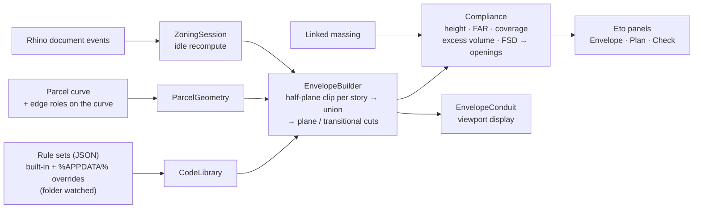

# Zoning Envelope

**See what the zoning code allows, live, on the parcel.**

A Rhino 8 plugin that turns a zoning rule set (setbacks, height, daylight /
encroachment planes, transitional height, FAR, coverage, density) into the
buildable envelope on a parcel, and checks a massing against it while you
design. Per-facade exterior-wall opening limits (CBC / IBC Table 705.8) come
out of the same geometry.

<sub>Rhino 8 · C# / RhinoCommon · Eto · JSON rule sets · v0.6 · prototype for feasibility conversations</sub>

---

## Problem

Early feasibility runs on a loop: an architect sketches a massing, someone
reads the zoning code, someone else redraws the setbacks, and the answer to
"does this fit?" arrives a day later, after the design has moved. The rules
are well defined; they just are not in the model.

## What it does

1. Pick the parcel curve and click the street edge. Side and rear edges are
   assigned automatically (`ZoneEdgeFlags` to change them).
2. Choose a rule set. The envelope appears as a translucent solid; setback
   lines and edge labels are drawn on the ground.
3. Link a massing. The **Zoning Check** panel shows height, floor area vs FAR,
   footprint vs coverage, volume outside the envelope (drawn in red) and the
   allowed opening percentage on every facade.
4. Move the parcel, edit the massing or save the rule JSON: everything
   recomputes on the next idle tick.

## Architecture



- **Rules are data.** Each jurisdiction is one JSON file that carries its
  `source` (code section) and a `verified` note. A new zone is a new file,
  not a new build, and a user file with the same `id` overrides the
  built-in one.
- **Live, but never in the way.** Document events only mark the session
  dirty; geometry is rebuilt on Rhino's idle event, so dragging a massing
  stays smooth.
- **Display before bake.** The envelope is drawn by a display conduit and
  only enters the document on `ZoneBake`, so it never pollutes the model.

## Demo

<!-- TODO: 20–30 s GIF: pick parcel → pick zone → drag massing until the red excess volume disappears. -->

Typical run, about a minute: open a site plan, `ZoneEnvelope`,
`ZoneSetParcel` (click near the street edge), pick `lamc-r3-hd1`,
`ZoneSetMassing`, then push the massing until the red excess volume and the
FAR warning clear.

The engine also runs without Rhino:

```powershell
dotnet run --project tests\EngineSmoke
```

## Design decisions and trade-offs

- **Show sources, never hide uncertainty.** Every rule set is labelled with
  where it came from and when it was checked; the panel lists what is *not*
  modeled. This is a feasibility aid, not a zoning determination
  (see [`docs/CODE-NOTES.md`](docs/CODE-NOTES.md)).
- **Convex parcels.** Setbacks are half-plane clips, which is fast and robust
  but over-cuts a concave corner. Acceptable for the lots this targets;
  a straight-skeleton offset is the fix if it is not.
- **What the tool cannot see stays a note.** Prevailing setbacks, hillside
  rules, overlays and density bonuses are listed per rule set, not guessed.

## Commands

| Command | Purpose |
| --- | --- |
| `ZoneEnvelope` | Open all three panels (`ZonePlan`, `ZoneCheck` open one each) |
| `ZoneSetParcel` | Select the parcel curve, then click near the front edge |
| `ZoneSetMassing` | Link a massing object to check |
| `ZoneEdgeFlags` | Per edge: role (front / side / rear), street + street width, adjacent low-density lot |
| `ZoneBake` | Add the envelope solid(s) to the document on layer "Zoning Envelope" |
| `ZoneReloadCodes` | Re-read the rule folder |

Edge flags matter for two rules: a street edge measures fire separation
distance to the street centerline; an "adjacent low density" edge triggers
transitional height (LA) or the R1-boundary setbacks (Santa Monica).

## Rule sets included

| id | Jurisdiction | Highlights |
| --- | --- | --- |
| `lamc-r1-hd1` | Los Angeles R1 | 20% depth front, narrow-lot side rule, 28/33 ft, 45 deg encroachment plane at 20 ft, RFA 0.45 |
| `lamc-r2-hd1` | Los Angeles R2 | R1 yards, 33 ft, FAR 3, 2,500 sf per unit |
| `lamc-rd1.5-hd1` | Los Angeles RD1.5 | 15 ft front, side grows per story, 45 ft, 1,500 sf per unit |
| `lamc-rd2-hd1` | Los Angeles RD2 | as RD1.5 with 2,000 sf per unit |
| `lamc-r3-hd1` | Los Angeles R3 | side yard grows 1 ft per story above the 2nd, 45 ft, FAR 3, 800 sf per unit |
| `lamc-r3-1xl` | Los Angeles R3 1XL | same yards, 2 stories / 30 ft |
| `lamc-r4-hd1` | Los Angeles R4 | rear yard grows above the 3rd story, no height limit (drawn to 150 ft), FAR 3, 400 sf per unit |
| `lamc-c2-1vl` | Los Angeles C2 1VL | no yards, 3 stories / 45 ft, FAR 1.5, transitional height 25 / 33 / 61 ft |
| `smmc-r1` | Santa Monica R1 | 10% width side, 28/32 ft, 45% coverage |
| `smmc-r2` | Santa Monica R2 | 8 ft or 16% side, 30 ft, 23 ft / 45 deg daylight plane, 2 ft upper-story side stepback, R1-boundary setbacks |
| `smmc-r3` | Santa Monica R3 | 3 stories / 40 ft, 35 ft daylight plane, 10 ft front stepback above the 2nd story, 50% coverage, 1,500 sf per unit (max 5) |
| `smmc-r4` | Santa Monica R4 | 4 stories / 45 ft, 40 ft daylight plane, same stepbacks, 1,250 sf per unit (max 6) |
| `cbc-2022-705-8` | CBC 2022 | max exterior wall openings by fire separation distance |

## Adding or editing a rule set

Rule files are JSON. Built-in ones are embedded in the plugin; your own go in
`%APPDATA%\ZoningEnvelope\codes\`. A user file with the same `id` overrides the
built-in one. The folder is watched, so saving a file updates the envelope
immediately. "Edit JSON" in the panel copies the current built-in file to that
folder and opens it.

Schema (all lengths in feet):

```jsonc
{
  "id": "my-zone", "kind": "zone",
  "jurisdiction": "City", "name": "Zone name", "source": "code section", "verified": "date + how",
  "notes": ["anything not modeled"],
  "setbacks": {
    "front": { "feet": 15, "percentOfLotDepth": 20, "minFeet": 0, "maxFeet": 20 },
    "side":  { "feet": 5, "narrowLot": { "widthLessThanFeet": 50, "percentOfLotWidth": 10, "minFeet": 3 },
               "perStoryAboveStory": 2, "perStoryFeet": 1, "perStoryMaxFeet": 16 },
    "rear":  { "feet": 15 }
  },
  "height": { "maxFeet": 45, "pitchedRoofMaxFeet": 0, "maxStories": 0, "storyHeightFeet": 10, "displayCapFeet": 150 },
  "floorArea": { "ratio": 3.0, "label": "FAR" },
  "coverage": { "maxPercent": 45 },
  "density": { "lotAreaPerUnitSqFt": 800, "maxUnits": 0 },
  "stepbacks": [ { "sides": ["side"], "aboveStory": 1, "additionalFeet": 2, "label": "..." } ],
  "planes": [ { "sides": ["front","side"], "startHeightFeet": 20, "angleDegrees": 45, "from": "setbackLine", "label": "..." } ],
  "transitionalHeight": { "trigger": "adjacentLowDensity",
                          "steps": [ { "upToFeet": 50, "maxHeightFeet": 25 } ], "label": "..." },
  "adjacentLowDensitySetbacks": { "sideFeet": 10, "rearFeet": 20 }
}
```

Setback resolution: base `feet`, then the larger of any percent rules, then the
narrow-lot override, then min/max, then per-story growth. Stepbacks add on top
for stories above `aboveStory`. `maxFeet: 0` on height means no limit; the
envelope is drawn to `displayCapFeet`.

## How the envelope is built (detail)

1. Parcel polyline oriented counter-clockwise; each edge gets a role.
2. For each story (or once, if no rule depends on the story) the parcel polygon
   is clipped by each edge's setback half-plane and extruded to that story's top.
3. Slabs are unioned, then cut by each plane rule (half-space above a plane that
   starts at the setback line at the given height and rises inward) and by each
   transitional-height band (everything above the step height within the band).
4. Compliance: massing height from its bounding box, floor plates by horizontal
   sections every `storyHeightFeet`, volume outside the envelope by boolean
   difference, fire separation distance per vertical face to the parcel edge it
   faces (plus half the street width on street edges).

Limits: parcels are treated as convex for setbacks (a concave corner is
over-cut), grade is the parcel's Z, and rules that depend on things the tool
cannot see (prevailing setback, hillside, overlays, bonuses) are listed in the
notes column, not modeled.

## Build and install

Requires Rhino 8 (runs on .NET 8) and the .NET 8+ SDK.

```powershell
powershell -ExecutionPolicy Bypass -File scripts\install-local.ps1
```

This builds to `dist\ZoningEnvelope.rhp`, copies it to
`%APPDATA%\McNeel\Rhinoceros\8.0\Plug-ins\ZoningEnvelope (<guid>)\<version>\`, and
writes the same registry entry the PlugInManager writes (load at startup). Do
not put it under `packages\`: Rhino's Package Manager deletes folders there
that it did not install itself. Close Rhino before running the script when the
plugin is already loaded; the `.rhp` is locked while loaded. Dragging the
`.rhp` onto the Rhino window also works, but registers it as load-on-demand.

Engine smoke test (no Rhino needed):

```powershell
dotnet run --project tests\EngineSmoke
```

## Layout

```
src/ZoningEnvelope/
  ZoningEnvelopePlugIn.cs   plugin entry, panel registration
  Model/                    rule schema (ZoneCode), library loader, parcel setup persisted on the curve
  Engine/                   parcel analysis, half-plane clipping, envelope builder, compliance + openings
  Session/                  live state, document events, idle recompute, bake
  Display/                  viewport conduit (envelope, setback lines, excess volume)
  UI/                       Eto panel and 2D plan diagram
  Commands/                 Zone* commands
  codes/                    built-in rule sets
docs/CODE-NOTES.md          per-rule sources, what is and is not modeled
scripts/install-local.ps1   build + install
tests/EngineSmoke           console checks for rules and clipping
```
